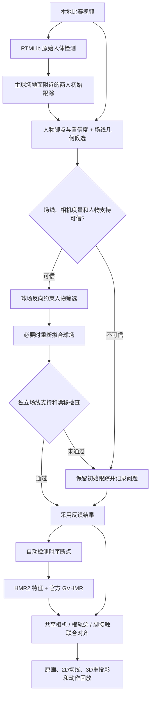

# 人物—球场—三维对齐统一管线

`integrated_scene_v1` 是当前默认方案。入口为仓库根目录的 `run_scene_pipeline.py`。它将已验证的 RTMLib、纯几何球场、预训练 GVHMR、共享相机和脚接触优化整合到同一输出目录，支持任意本地视频与内容校验后的断点恢复。

本版没有重新训练人体，也不加载此前实验性的球场神经网络。融合发生在观测、候选筛选、场景坐标和优化约束层面。

## 数据如何互相帮助



**人物帮助找球场**：两名目标的脚踝位置、置信度、跨帧分布与身体区域用于选定目标球场、排除邻场、屏蔽身体遮挡，并参与球场联合拟合。脚踝只是带误差的参考，不是精确地面接触点。

**球场反过来帮助找人物**：仅在几何证据可信时，使用松弛的场界约束排除明显位于目标场外的候选。允许出界救球；对可能腾空的脚踝允许随人物高度缩放的图像向下容差，避免把空中脚踝强行投到地面而误删选手。球场不可信时保留初始跟踪。

**反馈有边界**：最多两轮。反馈后若方向场线支持下降、匹配线减少、地面支持下降、视角分组改变，或角点漂移过大，则保留初始结果。提高自身评分不能单独成为接受理由；不会无限迭代放大一个错误场地。

**人体与球场共享三维坐标**：使用自动球场焦距代理初始化场景相机，结合身体 12 点重投影、预测支撑脚、滑动和轨迹连续性优化相机与人物整体位置。保持 GVHMR 的局部关节动作；男性瘦型只是可选显示外观。球网高点没有被平面 Homography 伪造成观测。

## 环境和模型

推荐沿用两个环境：

| 部分 | 环境要求 |
|---|---|
| 二维人物检测 | RTMLib、ONNX Runtime（CPU 或 CUDA） |
| 球场、跟踪与反馈 | NumPy、SciPy、OpenCV，CPU 即可 |
| 新视频原生三维推理 | 官方 GVHMR 环境、PyTorch 与 CUDA |
| 网格、对齐和导出 | SMPL-X、PyAV、Pillow，CPU 即可 |

辅助依赖见 `requirements-scene.txt`。GVHMR 请按其官方环境要求配置；代码和权重来自 [官方 GVHMR](https://github.com/zju3dv/GVHMR)，SMPL-X 模型须自行从 [官方渠道](https://smpl-x.is.tue.mpg.de/)取得许可。仓库不分发模型权重、SMPL-X 资产、原始比赛视频或大体积推理缓存。

默认上游目录为 `work/GVHMR`，也可通过参数指定其他位置。至少需要：

```text
<gvhmr-root>/
  hmr4d/...
  inputs/checkpoints/
    hmr2/epoch=10-step=25000.ckpt
    gvhmr/gvhmr_siga24_release.ckpt
    body_models/smplx/SMPLX_NEUTRAL.npz
```

男性展示资产可另放在任意路径，用 `--male-model` 指定。若没有男性资产，将配置中的 `render.avatar` 改为 `native`，使用原恢复外观。`configs/male_slim.json` 只保存固定显示形状参数，不含模型数据。

## 一条命令运行

以下为 PowerShell 示例；所有本机路径均通过参数提供，不要求特定盘符：

```powershell
python run_scene_pipeline.py `
  --video "path/to/match.mp4" `
  --output "outputs/match_integrated" `
  --pose-python "path/to/pose-env/python.exe" `
  --hmr-python "path/to/gvhmr-env/python.exe" `
  --gvhmr-root "path/to/GVHMR" `
  --male-model "path/to/SMPLX_MALE.npz" `
  --resume
```

入口自身的 Python 需安装 CPU 几何依赖；两个 `--*-python` 参数用于隔离 RTMLib 与 GVHMR 环境。不提供时均使用当前解释器。当前完整验证输入为 30 fps；其他帧率的动作恢复尚未验证，建议先统一到 30 fps 再运行。

有同一视频的原始检测 CSV 时，可加 `--detections path/to/pose_data_raw.csv`，跳过耗时的检测。这仍会重新进行目标筛选、双向反馈和场景对齐。CSV 需含 `frame_id`（从 1 开始）、`person_id` 或 `player_id`、`keypoint_id`、`x,y,confidence`，使用前 17 个 COCO 身体点；无效坐标保持未观测，不能伪装成有效关键点。

仅验证人物—球场部分：

```powershell
python run_scene_pipeline.py --video "match.mp4" --output "outputs/court_review" --court-only --resume
```

`--no-render` 可只生成三维参数与诊断。`--native-reference` 用于迁移此前实验缓存，必须同时核对视频字节、两人的关键点和框、分段、原生参数哈希；任一语义输入改变时会运行新推理，不直接套用旧动作。

## 输出、断点与可复现性

```text
outputs/<run>/
  job.json, job_*.json          本次输入和实际执行参数
  pipeline_status.json         当前阶段 / 失败原因所在日志
  stage_*.json                 阶段输入签名及输出内容哈希
  detections/                  原始 RTMLib 结果（如未提供 CSV）
  people_initial/              初始两人轨迹
  court_initial/scene/         初始球场、相机运动与候选诊断
  people_feedback/             球场反馈后的轨迹及排除统计
  court_feedback/scene/        有变化时的复核球场
  fusion.json                  接受 / 回退理由
  native_cache/, native/p0,p1/  特征、原生 GVHMR 参数
  cuts.json                    自动时序断点
  scene/inputs/                保持局部动作的人体几何与观测
  scene/results/scene/         相机、根轨迹、脚接触及误差
  reconstruction.mp4           完整时长回放
  verification.json            数值、原生参数和视频核对
  run_manifest.json            最终版本、配置与阶段签名
```

`--resume` 检查输入视频、配置、相关源码与依赖输入的内容指纹，并校验输出内容。关键点、框、权重或代码发生变化时，对应缓存失效；失败阶段不会把仅存在的半成品当成成功，也不会跳过后续必需步骤。

视频、CSV、模型和缓存都留在输出目录或用户指定目录。发布到 GitHub 的只有代码、配置、说明和轻量测试记录。禁止将账号 Cookie 或访问令牌写入配置；本管线不需要 OpenAI API 密钥或其他云服务凭据。

## 如何判断效果

回放将独立二维球场线（青色）与场景对齐后的三维球场重投影（金色）分别画出，人体骨架为三维重投影；下方原画和恢复动作可直接比较。不能把独立二维线的贴合程度，当成三维相机已经准确。

验收检查包括：

- 球场匹配线、双方向支持、相机度量一致性和反馈漂移；
- 未知/不可信球场不向人物强行反馈；
- 原生人体动作参数在对齐前后哈希不变；
- 所有根轨迹与相机参数有限，旋转为正常 SO(3)；
- 视频完整解码、输出时长与源视频匹配；
- 对比固定版本基线的身体重投影、场线重投影和脚接触代理量。

自动几何不等于逐厘米真值。目前初始地面筛选主要覆盖绿色场地；木地板、复杂灯光、严重畸变与持续遮挡还需独立测试。片段内使用共享相机近似；剪辑断点不平滑，跨剪辑的人物编号不保证代表同一身份。脚底滑动与快速挥拍仍可能有误差。

本版本由此前新视频实验整理并新增反馈保护，因此该视频属于集成回归样本。后续新视频应固定本配置直接运行，再判断跨场馆泛化，不能继续逐视频调参后宣称盲测成功。

## 回归测试

```powershell
python -m unittest discover -s tests -p test_scene_pipeline.py -v
python -m unittest discover -s tests -v
```

新增测试覆盖腾空容差、场外观众排除、出界救球、错误球场禁止反馈、反馈漂移、独立场线证据、人物参与求解、正向相机、缓存损坏和任意视频帧数。实际运行记录见 [统一管线验证](integrated_scene_validation.md)。
